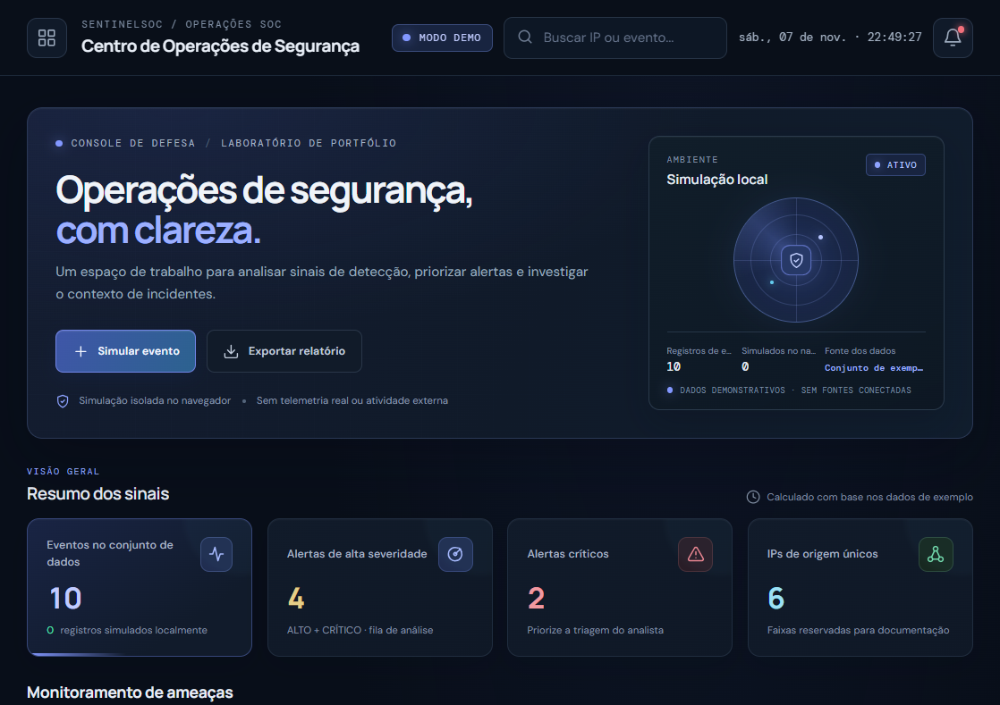

# SentinelSOC

## About

Painel SOC de defesa cibernética para demonstrar análise e triagem de alertas, monitoramento de ameaças e análise de endereços IP. Projeto de portfólio em HTML, CSS e JavaScript com dados fictícios e simulações locais.

[pietrosouza71.github.io/SentinelSoc/](https://pietrosouza71.github.io/SentinelSoc/)

O GitHub Actions publica o site automaticamente a cada atualização da branch `main`.

> Analise sinais, priorize alertas e explore o contexto de incidentes em um ambiente demonstrativo.

## Captura de tela

## Funcionalidades

- Painel responsivo com resumo dos eventos, alertas críticos e IPs de origem.
- Gráficos de eventos ao longo do tempo, severidade, atividade por IP e status da triagem.
- Alertas filtráveis por severidade, tipo de evento, status e endereço IP.
- Contexto demonstrativo das regras de detecção e referências à matriz MITRE ATT&CK.
- Análise de risco agregada por endereço IP.
- Simulação de eventos fictícios, com atualização de tabelas, indicadores e gráficos.
- Persistência das simulações no `localStorage` do navegador.
- Exportação dos relatórios de incidentes em JSON.
- Notificações visuais e opção para apagar os eventos simulados.

## Tecnologias

- HTML5 semântico
- CSS3, com layout responsivo e tema escuro
- JavaScript puro
- [Chart.js](https://www.chartjs.org/) para os gráficos
- `localStorage` para guardar as simulações no navegador

## Como executar

1. Clone ou baixe este repositório.
2. Abra `index.html` em um navegador moderno ou abra a pasta no VS Code e execute com a extensão **Live Server**.
3. Uma conexão com a internet é necessária para carregar o Chart.js e as fontes externas.

Não é necessário instalar dependências nem configurar um servidor de aplicação.

## Dados e segurança

Este painel é uma simulação de portfólio, não um SIEM nem uma ferramenta de monitoramento real. Os eventos, indicadores, níveis de confiança e mapeamentos são ilustrativos. Os endereços de IP pertencem a faixas reservadas para documentação. O projeto não coleta telemetria, não se conecta a sistemas externos e não executa ataques ou varreduras.
